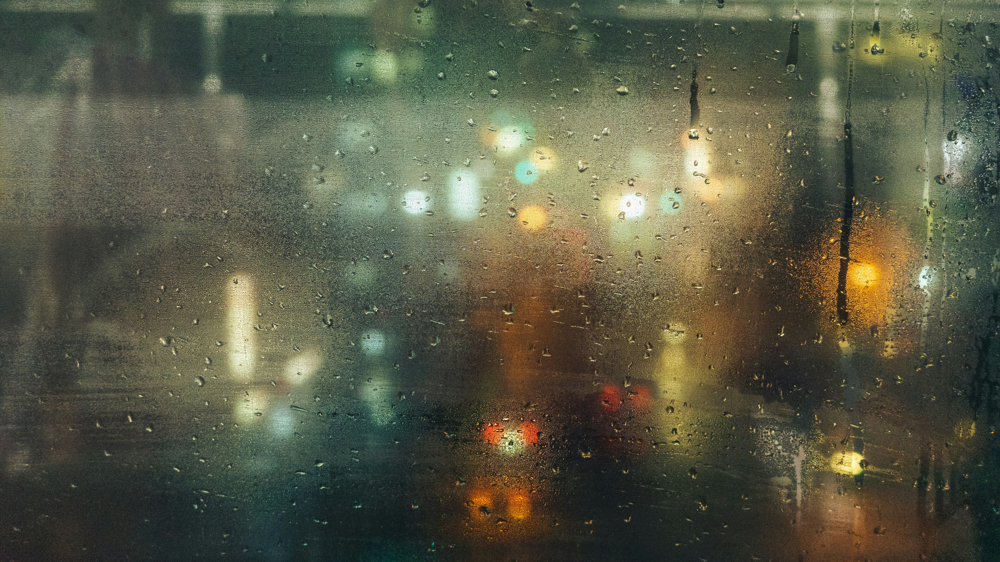

# Rainy Window

A dark moss-green Omarchy theme with an amber accent, built around city lights seen through rain on glass.



## Install

```sh
omarchy theme install https://github.com/gosumarchy/omarchy-rainy-window-theme
```

## Window look

The theme sets the palette, the dark window border color, the translucent bar,
menus, popups and notifications, the wallpapers and the icon theme.

Omarchy does not load Lua from installed themes, so window transparency, corners,
border width and the blur behind the bar have to go in your own
`~/.config/hypr/looknfeel.lua`. The setup this theme was made with:

```lua
hl.config({
  general = {
    border_size = 1,
    gaps_out = 12,
    gaps_in = 8,
  },
  decoration = {
    rounding = 10,
    active_opacity = 0.85,
    inactive_opacity = 0.75,
    blur = {
      enabled = true,
    },
    shadow = {
      enabled = true,
      range = 20,
      render_power = 3,
      color = "rgba(00000066)",
    },
  },
})

-- Blur behind the translucent shell surfaces.
hl.layer_rule({ match = { namespace = "omarchy-bar" }, blur = true, ignore_alpha = 0.1 })
hl.layer_rule({ match = { namespace = "omarchy-menu" }, blur = true, ignore_alpha = 0.1, no_anim = true })
hl.layer_rule({ match = { namespace = "omarchy-image-selector" }, blur = true, ignore_alpha = 0.1, no_anim = true })
hl.layer_rule({ match = { namespace = "omarchy-notifications" }, blur = true, ignore_alpha = 0.1 })
hl.layer_rule({ match = { namespace = "omarchy-osd" }, blur = true, ignore_alpha = 0.1 })
hl.layer_rule({ match = { namespace = "omarchy-clipboard" }, blur = true, ignore_alpha = 0.1 })
```

## Photo credits

All wallpapers are from Unsplash under the [Unsplash License](https://unsplash.com/license),
cropped to 3840x2160.

- `backgrounds/0-tokyo-window-rain.jpg`: [Red Shuheart](https://unsplash.com/photos/gLMShXh1N4Q)
- `backgrounds/1-traffic-light-rain.jpg`: [Andréas BRUN](https://unsplash.com/photos/_uDfd0eeOik)
- `backgrounds/2-amber-bokeh-rain.jpg`: [freestocks](https://unsplash.com/photos/Imvn4PWHPcQ)
- `backgrounds/3-neon-window-rain.jpg`: [lesha tuman](https://unsplash.com/photos/H8R6aIW_OdE)
